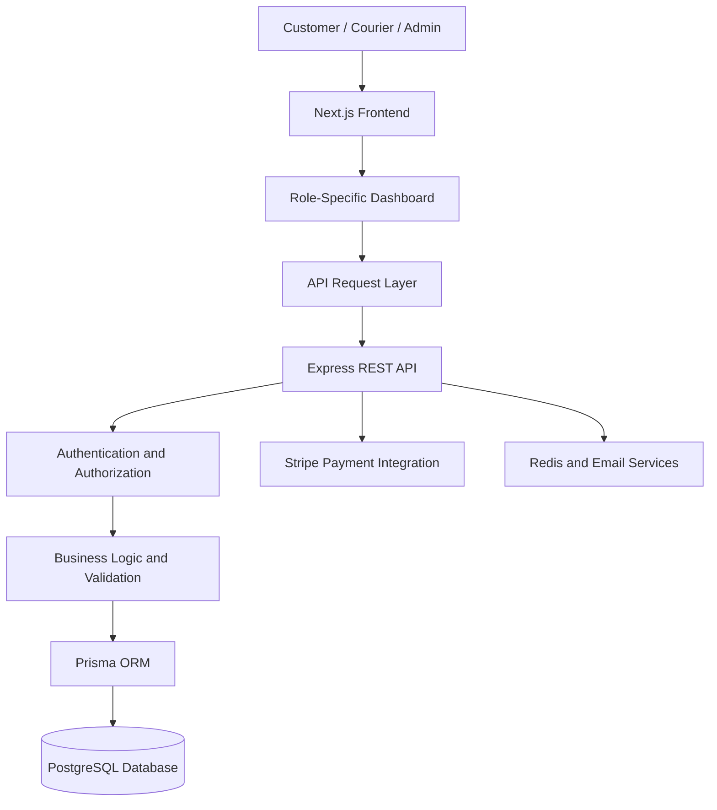

# 🚚 Courier & Logistics Platform

### A Modern, Secure & Scalable Logistics Management System

A full-stack courier and logistics management platform designed to simplify shipment creation, parcel tracking, courier operations, payment processing, and administrative management through a modern, responsive web application.

The platform provides dedicated experiences for **Customers, Couriers, and Administrators**, enabling each role to manage its responsibilities through a centralized digital logistics ecosystem.

<p align="center">

**Next.js · TypeScript · Tailwind CSS · TanStack Query · Node.js · Express · PostgreSQL · Prisma**

</p>

---

## 📌 Table of Contents

- [Overview](#-overview)
- [Project Objectives](#-project-objectives)
- [Key Features](#-key-features)
- [User Roles](#-user-roles)
- [Application Screens](#-application-screens)
- [Technology Stack](#-technology-stack)
- [System Architecture](#-system-architecture)
- [Project Structure](#-project-structure)
- [Getting Started](#-getting-started)
- [Environment Configuration](#-environment-configuration)
- [Installation and Development](#-installation-and-development)
- [Authentication and Authorization](#-authentication-and-authorization)
- [API Integration](#-api-integration)
- [Frontend Architecture](#-frontend-architecture)
- [UI and Design Principles](#-ui-and-design-principles)
- [Error Handling and Loading States](#-error-handling-and-loading-states)
- [Security Considerations](#-security-considerations)
- [Production Build](#-production-build)
- [Deployment on Vercel](#-deployment-on-vercel)
- [Troubleshooting](#-troubleshooting)
- [Development Guidelines](#-development-guidelines)
- [Future Improvements](#-future-improvements)
- [Contributing](#-contributing)
- [License](#-license)
- [Contact](#-contact)

---

## 🌟 Overview

The Courier & Logistics Platform is a web-based application built to manage the essential operations of a courier service, from creating shipments to delivering parcels and tracking their progress.

The application separates responsibilities across three role-based dashboards, providing an organized interface for customers, courier personnel, and administrators.

Customers can create shipments and monitor deliveries. Couriers can manage their availability and assigned deliveries. Administrators can oversee users, courier applications, shipments, payments, hubs, and reviews.

The frontend communicates with a REST API backend and uses modern React ecosystem tools to provide a responsive, maintainable, and interactive user experience.

### Project Repositories

| Component        | Details                                                                                              |
| ---------------- | ---------------------------------------------------------------------------------------------------- |
| Frontend         | Next.js web application                                                                              |
| Backend          | [Courier & Logistics Platform Backend](https://github.com/nio420/Courier-Logistics-Platform-backend) |
| Backend API      | `https://courier-logistics-platform.vercel.app/api/v1`                                               |
| Frontend Hosting | Vercel                                                                                               |
| Database         | PostgreSQL                                                                                           |
| ORM              | Prisma                                                                                               |

> **Note:** Add the frontend GitHub repository URL after publishing this frontend repository. The backend URL and API base URL above are the currently configured project references.

---

## 🎯 Project Objectives

The main objectives of this project are to:

- Digitize shipment creation and delivery management.
- Provide customers with shipment tracking and payment visibility.
- Enable couriers to manage availability and delivery assignments.
- Give administrators centralized operational control.
- Implement role-based authentication and authorization.
- Integrate online payments through Stripe.
- Maintain a consistent API-driven frontend architecture.
- Deliver a responsive interface across desktop, tablet, and mobile devices.
- Follow maintainable coding practices and production-oriented development workflows.

---

## ✨ Key Features

### 🔐 Authentication and Account Management

- User registration and login.
- Credential-based authentication.
- Google OAuth login integration.
- Email verification workflow.
- Password reset workflow.
- Authentication-aware navigation.
- Role-based route protection.
- Session and token refresh handling, according to backend authentication behavior.
- Protected customer, courier, and administrator areas.

### 📦 Shipment Management

- Create and manage customer shipments.
- View personal shipment records.
- Access shipment details and delivery information.
- Track shipment progress.
- Display shipment status and relevant timestamps.
- Support shipment management workflows for authorized administrators.
- Connect shipment interfaces to the backend API.

### 📍 Shipment Tracking

- Track shipment progress through its current status.
- Display available tracking history.
- Present shipment lifecycle information in an understandable timeline.
- Make delivery progress accessible through a dedicated tracking interface.

### 💳 Payment Management

- Stripe-based payment integration.
- Customer payment history.
- Payment status visibility.
- Administrative payment management.
- Integration with backend-managed payment records.

### 🚴 Courier Dashboard

- Courier dashboard overview.
- Availability management.
- Assigned shipment management.
- Assignment status visibility.
- Courier earnings overview based on available backend data.
- Customer feedback and review display.
- Role-protected courier routes.

### 🛡️ Administrator Dashboard

- Administrative overview and statistics.
- Courier application management.
- Courier approval and rejection workflows.
- Courier availability and approval status visibility.
- User management.
- Hub management.
- Shipment management.
- Payment management.
- Review management.
- Profile management.
- Pagination and filtering where supported by the relevant API.

### ⭐ Review and Feedback System

- Display customer reviews and ratings.
- Present review information associated with shipments and couriers where available.
- Support review-related API integration.
- Provide administrative review management interfaces.

### 📱 Responsive User Interface

- Responsive layouts for desktop, tablet, and mobile.
- Dedicated dashboard sidebars.
- Mobile-friendly navigation.
- Reusable UI components.
- Consistent spacing and typography.
- Loading, empty, and error states.
- Tables and data views designed to work on smaller screens.

> Feature availability depends on the corresponding frontend implementation and backend API support. Payment completion, courier assignment, approval, and shipment status transitions remain subject to backend authorization and business rules.

---

## 👥 User Roles

The application is organized around three primary roles.

### 1. Customer

Customers use the platform to manage shipments and monitor deliveries.

**Typical capabilities:**

- Register and sign in.
- Create shipments.
- View personal shipments.
- Track delivery progress.
- Review payment history.
- Access reviews and profile-related functionality.

### 2. Courier

Couriers use a dedicated dashboard to manage delivery assignments and availability.

**Typical capabilities:**

- Access assigned deliveries.
- Manage availability.
- View assignment information.
- Follow supported delivery workflows.
- Review earnings information.
- View customer feedback.

### 3. Administrator

Administrators manage platform operations and oversee logistics activities.

**Typical capabilities:**

- View administrative statistics.
- Manage courier applications.
- Review courier approval status.
- Manage users and hubs.
- Monitor shipments and payments.
- Review customer feedback.
- Access administrative profile functionality.

**Authorization principle:** The frontend provides role-aware navigation and route protection, while the backend must independently enforce all permissions and business rules.

---

## 🖥️ Application Screens

The frontend is organized into public pages and role-specific dashboards.

| Area           | Pages and interfaces                                                   |
| -------------- | ---------------------------------------------------------------------- |
| Public         | Landing page, authentication pages, shipment tracking                  |
| Authentication | Login, registration, email verification, password reset                |
| Customer       | Overview, shipments, payment history, tracking, reviews                |
| Courier        | Overview, availability, assignments, earnings, reviews                 |
| Administrator  | Overview, couriers, users, hubs, shipments, payments, reviews, profile |

The exact pages and available actions depend on the current implementation and the endpoints exposed by the backend.

### Dashboard Design

The dashboard architecture uses separate layouts and sidebar components for different roles. Shared application components help keep the interface consistent while allowing each role to have its own navigation and workflows.

---

## 🧰 Technology Stack

### Frontend

| Technology                                          | Purpose                                   |
| --------------------------------------------------- | ----------------------------------------- |
| [Next.js](https://nextjs.org/)                      | React framework and App Router            |
| [React](https://react.dev/)                         | Component-based user interfaces           |
| [TypeScript](https://www.typescriptlang.org/)       | Static typing and maintainability         |
| [Tailwind CSS](https://tailwindcss.com/)            | Utility-first styling                     |
| [shadcn/ui](https://ui.shadcn.com/)                 | Reusable UI components, where used        |
| [TanStack Query](https://tanstack.com/query/latest) | Server-state management and data fetching |
| [React Hook Form](https://react-hook-form.com/)     | Form state management, where used         |
| [Zod](https://zod.dev/)                             | Schema validation                         |
| [Sonner](https://sonner.emilkowal.ski/)             | Toast notifications                       |
| [Lucide](https://lucide.dev/)                       | Icons                                     |
| [Recharts](https://recharts.org/)                   | Dashboard charts, where used              |
| [Biome](https://biomejs.dev/)                       | Code formatting and linting               |

### Backend

The frontend integrates with a separate backend application built around the following technologies:

| Technology | Purpose                                                                  |
| ---------- | ------------------------------------------------------------------------ |
| Node.js    | JavaScript runtime                                                       |
| Express.js | REST API framework                                                       |
| TypeScript | Backend type safety                                                      |
| PostgreSQL | Relational database                                                      |
| Prisma ORM | Database access and schema management                                    |
| Zod        | Request validation                                                       |
| Redis      | Supporting authentication and temporary data workflows, where configured |
| Stripe     | Payment processing                                                       |

### Development and Deployment

- Git and GitHub for version control.
- Visual Studio Code for development.
- Vercel for frontend hosting.
- Environment variables for deployment-specific configuration.
- REST APIs for frontend/backend communication.

---

## 🏗️ System Architecture

The application follows a frontend-backend architecture.



### Architecture Responsibilities

**Frontend**

- Renders the user interface.
- Collects and validates form input.
- Requests data from the backend.
- Displays loading, success, and error states.
- Protects dashboard navigation based on the authenticated user's role.

**Backend**

- Authenticates requests.
- Enforces role-based permissions.
- Validates request payloads.
- Executes business logic.
- Reads and writes database records.
- Processes payment-related operations.
- Returns API responses to the frontend.

**Database**

- Stores application records and relationships.
- Maintains persistent shipment, user, payment, and other business data.

**External services**

- Stripe supports online payment processing.
- Redis and email services support the backend workflows configured for the application.

---

## 📂 Project Structure

The frontend uses the Next.js App Router and a component-oriented organization.

A simplified view of the project structure is shown below. Keep the actual filenames and folders aligned with the repository.

```text
courier-logistics-frontend/
│
├── public/
│   ├── images/
│   └── icons/
│
├── src/
│   ├── app/
│   │   ├── layout.tsx
│   │   ├── page.tsx
│   │   ├── globals.css
│   │   │
│   │   ├── (public)/
│   │   ├── (auth)/
│   │   ├── customer/
│   │   ├── courier/
│   │   └── admin/
│   │
│   ├── components/
│   │   ├── admin/
│   │   ├── auth/
│   │   ├── courier/
│   │   ├── customer/
│   │   ├── shared/
│   │   └── ui/
│   │
│   ├── hooks/
│   ├── lib/
│   │   ├── api.ts
│   │   └── utils.ts
│   │
│   ├── providers/
│   ├── services/
│   ├── types/
│   └── middleware.ts
│
├── .vscode/
│   ├── settings.json
│   └── extensions.json
│
├── .env.example
├── .gitignore
├── biome.json
├── next.config.ts
├── package.json
├── package-lock.json
├── tsconfig.json
├── vercel.json
└── README.md
```

> **Important:** This is a documentation-oriented structure, not a verified file-by-file inventory. Some folders may not exist in the current repository, and your actual App Router route groups or service organization may differ. Do not create empty folders just to match this illustration.

### Code Organization Principles

- Keep route files focused on page composition.
- Extract complex UI into separate components.
- Separate API requests from presentation logic.
- Reuse shared components where appropriate.
- Keep TypeScript types explicit and understandable.
- Avoid unnecessary abstractions and duplicated code.

---

## 🚀 Getting Started

### Prerequisites

Before starting, install the following:

- [Node.js](https://nodejs.org/) — a version compatible with your installed Next.js release.
- npm, which comes with Node.js.
- Git.
- A code editor such as Visual Studio Code.
- Access to a running backend API.

Verify your installation:

```bash
node --version
npm --version
git --version
```

### Clone the Repository

After publishing the frontend repository to GitHub, clone it using its actual repository URL.

```bash
git clone <YOUR_FRONTEND_REPOSITORY_URL>
```

Move into the project directory:

```bash
cd courier-logistics-frontend
```

Install dependencies:

```bash
npm install
```

---

## ⚙️ Environment Configuration

Create a `.env.local` file in the project root.

```env
NEXT_PUBLIC_API_URL=https://courier-logistics-platform.vercel.app/api/v1
```

This is the currently configured API base URL for the frontend.

### Environment Variable Reference

| Variable                | Purpose                                         | Exposure                  |
| ----------------------- | ----------------------------------------------- | ------------------------- |
| `NEXT_PUBLIC_API_URL`   | Backend API base URL                            | Available to browser code |
| Other private variables | Only if explicitly required by server-side code | Server-side only          |

The API request layer should use the configured base URL rather than hardcoding endpoint URLs throughout individual components.

### Environment Variable Rules

1. Keep `.env.local` out of Git.
2. Never commit passwords, access tokens, refresh tokens, private API keys, or production secrets.
3. Never place backend JWT signing secrets in frontend environment variables.
4. Variables prefixed with `NEXT_PUBLIC_` are exposed to browser-side code.
5. Add the same required variables to the Vercel project settings for production deployments.
6. Use separate environment values for development, preview, and production when necessary.

Do not copy backend-only variables such as JWT signing secrets into the frontend environment. The backend must retain ownership of token signing and other private operations.

---

## 💻 Installation and Development

### Start the Development Server

```bash
npm run dev
```

Open the local application:

```text
http://localhost:3000
```

### Available Commands

| Command          | Purpose                                              |
| ---------------- | ---------------------------------------------------- |
| `npm run dev`    | Start the development server                         |
| `npm run build`  | Compile and generate the production build            |
| `npm run start`  | Start the production server after a successful build |
| `npm run lint`   | Run the configured Biome checks                      |
| `npm run format` | Run the configured Biome formatter                   |

The exact behavior of each script is defined in `package.json`.

For a project configured with Biome, you can also run:

```bash
npx biome check .
```

To apply supported automatic fixes:

```bash
npx biome check --write .
```

To format files:

```bash
npm run format
```

Review the scripts in `package.json` before using additional flags or changing the formatting workflow.

---

## 🔑 Authentication and Authorization

Authentication is handled through the backend API and the frontend's authentication-related components.

The frontend should follow the backend's actual token and cookie behavior rather than implementing an independent authentication mechanism.

### Authentication Workflows

- Credential-based login.
- User registration.
- Google login.
- Email verification.
- Password reset.
- Authenticated-user retrieval.
- Token refresh, when supported by the backend.
- Logout and authentication-state cleanup.

### Role-Based Route Protection

The platform uses three application roles:

```text
CUSTOMER
COURIER
ADMIN
```

Protected pages should verify the current user's authentication state and permitted role before displaying role-specific content.

### Authentication Best Practices

- Keep authentication checks centralized where practical.
- Handle expired sessions gracefully.
- Avoid displaying protected data to unauthorized users.
- Do not trust a role value supplied by the browser without backend verification.
- Keep refresh and access token handling consistent with backend cookie and credential requirements.
- Ensure protected API endpoints independently enforce authorization.

---

## 🔌 API Integration

The frontend communicates with the backend through HTTP requests.

### API Base URL

```text
https://courier-logistics-platform.vercel.app/api/v1
```

### Example API Endpoints

The following are examples of endpoint paths used or relevant to the integration. Confirm each route against the backend router before relying on it.

| Purpose                      | Example endpoint                  |
| ---------------------------- | --------------------------------- |
| Current authenticated user   | `GET /auth/me`                    |
| Refresh authentication token | `POST /auth/refresh-token`        |
| Personal shipments           | `GET /shipments/my-shipments`     |
| Create a review              | `POST /reviews`                   |
| Courier reviews              | `GET /reviews/courier/:courierId` |
| Administrative overview      | `GET /admin/overview`             |
| Administrative couriers      | `GET /admin/couriers`             |
| Pending courier applications | `GET /admin/courier-pending`      |

Full URLs are formed by combining the configured API base URL with the endpoint path.

For example:

```text
GET https://courier-logistics-platform.vercel.app/api/v1/auth/me
```

### API Request Principles

- Use the shared API request utility where available.
- Keep request handling separate from UI components.
- Include credentials when required by the backend's cookie-based authentication.
- Pass pagination and filtering parameters supported by the endpoint.
- Handle non-success HTTP responses.
- Validate and type API response data appropriately.
- Avoid duplicating API base URLs across the application.

### API Response Format

The backend contract uses a consistent response structure.

Successful response:

```json
{
  "success": true,
  "message": "Request completed successfully",
  "data": {}
}
```

Error response:

```json
{
  "success": false,
  "message": "Request could not be completed",
  "errors": []
}
```

These examples illustrate the response contract; actual response fields depend on the endpoint.

### Pagination and Filtering

For list endpoints that support pagination, use the parameters defined by the backend.

Example:

```text
GET /admin/couriers?page=1&limit=10
```

Additional supported parameters may include:

```text
searchTerm
sortBy
sortOrder
approvalStatus
availabilityStatus
```

Do not assume every endpoint supports the same parameters. The backend endpoint's validation schema and implementation are the source of truth.

---

## 🧩 Frontend Architecture

### Next.js App Router

The application uses Next.js App Router conventions for routing and layouts.

- `page.tsx` files define route pages.
- `layout.tsx` files provide shared layout composition.
- Shared components prevent unnecessary duplication.
- Client Components are used where browser-side interaction or React hooks require them.
- Server Components should remain the default where practical.

### Server State with TanStack Query

TanStack Query is used to manage server-driven data where configured.

Typical responsibilities include:

- Fetching API data.
- Caching responses.
- Loading and error state management.
- Refetching after relevant operations.
- Invalidating queries after mutations.
- Keeping dashboard data synchronized with backend changes.

Query keys should identify the relevant resource and its parameters.

### Forms and Validation

Forms should provide:

- Clear field labels.
- Appropriate client-side validation.
- Helpful validation messages.
- Submission loading states.
- Success and error notifications.
- Server-side validation compatibility.

Client-side validation improves usability but does not replace backend validation.

### Component Reusability

Reusable components should be extracted when doing so improves readability and consistency.

Examples include:

- Dashboard sidebars.
- Status badges.
- Data tables.
- Pagination controls.
- Confirmation dialogs.
- Form fields.
- Loading skeletons.
- Empty states.
- Error messages.

Keep components focused and avoid unnecessary abstraction.

---

## 🎨 UI and Design Principles

The interface aims to provide a clean, professional, and trustworthy logistics experience.

### Design Goals

- Consistent typography and spacing.
- Clear information hierarchy.
- Predictable navigation.
- Readable data tables.
- Responsive dashboard layouts.
- Accessible form controls.
- Appropriate feedback for user actions.
- Consistent colors for shipment and payment statuses.

### Responsive Design

The application should work across:

- Desktop computers.
- Laptops.
- Tablets.
- Mobile phones.

On small screens, navigation and tables should adapt without introducing unnecessary horizontal overflow.

### Accessibility

Recommended accessibility practices include:

- Semantic HTML.
- Accessible form labels.
- Keyboard navigation.
- Visible focus states.
- Sufficient color contrast.
- Descriptive button labels.
- Appropriate dialog and menu behavior.

---

## 🔄 Error Handling and Loading States

A production-oriented interface should handle expected application states explicitly.

### Loading

Display an appropriate loading indicator or skeleton while data is being fetched.

### Empty Results

Provide a useful message when a list contains no records.

Example:

> No shipments found. Create a shipment to get started.

### API Errors

Display a meaningful message when an API request fails. Avoid exposing stack traces, private backend details, or sensitive response payloads to end users.

### Form Submission

Prevent accidental repeated submissions where appropriate and show feedback after successful or failed operations.

### Network Failures

Provide a reasonable retry or recovery path when an operation can safely be retried.

---

## 🔒 Security Considerations

Security is a shared responsibility between the frontend and backend.

### Frontend

- Do not expose private secrets in client-side code.
- Validate user input.
- Avoid rendering untrusted HTML.
- Handle authentication failures correctly.
- Protect dashboard navigation from unauthorized access.
- Avoid logging sensitive authentication data.
- Keep dependencies updated.

### Backend

- Enforce authentication and role authorization.
- Validate requests on the server.
- Verify payment events using trusted server-side mechanisms.
- Protect private endpoints.
- Apply appropriate rate limiting and security headers.
- Store passwords using secure password hashing.
- Manage secrets through environment variables.

### Deployment

- Configure production environment variables securely.
- Use HTTPS.
- Keep `.env.local` and other secret files out of version control.
- Never commit private keys or credentials.
- Review build logs for accidental secret exposure.

**Important:** Frontend route protection is not a security boundary by itself. All sensitive operations must be authorized by the backend.

---

## 🏗️ Production Build

Before deploying, run the following commands:

```bash
npm run lint
npm run build
```

Resolve errors before proceeding to deployment.

After a successful build, you can test the production server locally:

```bash
npm run start
```

Open:

```text
http://localhost:3000
```

The production start command should be run only after a successful production build.

---

## ☁️ Deployment on Vercel

The frontend is intended to be deployed on Vercel.

### Step 1: Push the Frontend to GitHub

Make sure the frontend repository contains the required source files and configuration.

```bash
git status
git add .
git commit -m "Prepare frontend for deployment"
git push origin main
```

Before staging files, verify that no environment files or secrets are included.

### Step 2: Import the Repository

1. Open [Vercel](https://vercel.com/).
2. Create or open a Vercel project.
3. Import the frontend GitHub repository.
4. Select Next.js as the framework if automatic detection does not select it.
5. Confirm the build configuration.

### Step 3: Configure Environment Variables

In Vercel, open:

**Project → Settings → Environment Variables**

Add the production API URL:

```env
NEXT_PUBLIC_API_URL=https://courier-logistics-platform.vercel.app/api/v1
```

Add any other variables only when the frontend genuinely requires them.

Do not add backend JWT signing secrets to a browser-facing frontend deployment.

### Step 4: Deploy

Deploy the project through Vercel.

When the repository is connected to GitHub, new commits pushed to the configured production branch can trigger automatic deployments.

### Step 5: Verify the Deployment

After deployment, check:

- The landing page loads.
- Authentication pages render correctly.
- The frontend can reach the backend.
- Browser console errors are resolved.
- Protected routes handle authentication correctly.
- Dashboard data loads as expected.
- Payment workflows use the intended Stripe environment.
- Mobile layouts remain usable.
- Production build logs contain no unresolved errors.

### Backend Dependency

The frontend depends on a reachable backend API. A successful frontend deployment does not automatically guarantee that authentication, shipments, payments, or dashboard operations will work. Verify the backend routes, CORS configuration, environment variables, and service availability separately.

---

## 🐛 Troubleshooting

### 1. Production Build Fails During Prerendering

If Next.js reports:

```text
useSearchParams() should be wrapped in a suspense boundary
```

Check components that use `useSearchParams()`.

Wrap the component that calls the hook in an appropriate React `Suspense` boundary. The boundary must be above the component using the hook.

For example:

```tsx
import { Suspense } from "react";
import GoogleLoginToast from "@/components/auth/GoogleLoginToast";

<Suspense fallback={null}>
  <GoogleLoginToast />
</Suspense>;
```

Place this inside the relevant layout or parent component while preserving the existing layout structure.

Other components using `useSearchParams()` may require the same treatment depending on how they are rendered.

### 2. API Requests Return 400

A `400 Bad Request` response often indicates invalid query parameters, missing required data, or a request body that does not match backend validation.

To investigate:

1. Open browser DevTools.
2. Select the Network tab.
3. Inspect the failing request.
4. Check the query parameters and request body.
5. Read the response's validation error.
6. Compare the request with the backend validation schema.

Do not fix a validation error by guessing the expected payload.

### 3. API Requests Return 401 or 403

Check:

- Whether the user is authenticated.
- Whether credentials are included when required.
- Whether the session or token has expired.
- Whether the user has the required role.
- Whether the backend authentication and refresh flows are working.

### 4. API Requests Fail Because of CORS

Check the backend's allowed origins and credentials configuration.

The backend must permit the deployed frontend origin. When using credentialed requests, the CORS configuration must be compatible with browser credential rules.

### 5. Dashboard Data Does Not Load

Verify:

- The API base URL.
- The endpoint path.
- The authenticated user's role.
- The response format.
- The TanStack Query configuration.
- Query keys and invalidation behavior.
- Backend availability.

### 6. Vercel Deployment Fails

Inspect the deployment build logs.

Common causes include:

- TypeScript errors.
- Missing environment variables.
- Prerendering errors.
- Incorrect import paths.
- Invalid configuration.
- Dependency or package-lock inconsistencies.

Fix the underlying error and redeploy.

---

## 🧑‍💻 Development Guidelines

The project follows a simple, maintainable development workflow.

### Coding Standards

- Prefer readable and beginner-friendly TypeScript.
- Keep page components focused on layout and composition.
- Extract substantial UI into separate components.
- Use the shared API request layer.
- Use TanStack Query for server-state operations where configured.
- Keep validation consistent with backend contracts.
- Avoid unnecessary dependencies.
- Avoid duplicate API logic.
- Do not introduce mock production data to conceal missing API functionality.
- Use pagination where the backend supports it.
- Test affected routes after changing shared layouts or providers.

### Before Opening a Pull Request

Run:

```bash
npm run lint
npm run build
```

Review the diff:

```bash
git diff
git status
```

Ensure that secrets, generated build output, and unrelated files are not included.

### Suggested Git Workflow

```bash
git switch -c feature/your-feature-name
```

Make changes and validate them.

```bash
git add .
git commit -m "Add your feature"
git push -u origin feature/your-feature-name
```

Open a pull request and describe the changes, tests, and any known limitations.

---

## 🚀 Future Improvements

Potential future enhancements include:

- Real-time shipment tracking updates.
- Interactive maps and delivery route visualization.
- More advanced shipment search and filtering.
- Exportable shipment and payment reports.
- Enhanced analytics dashboards.
- Additional accessibility improvements.
- Automated frontend tests.
- End-to-end tests for important customer journeys.
- Performance monitoring and error reporting.
- Expanded integration and deployment checks.

These items are potential enhancements, not claims that the functionality is already implemented.

---

## 🤝 Contributing

Contributions that improve usability, reliability, accessibility, and maintainability are welcome.

### Contribution Process

1. Fork or clone the repository.
2. Create a feature branch.
3. Make focused changes.
4. Run lint and production build checks.
5. Review your changes.
6. Submit a pull request with a clear description.

Please keep pull requests focused and avoid including unrelated formatting changes or secret configuration files.

---

## 📄 License

No license has been specified in this README.

Before publishing the repository as an open-source project, choose an appropriate license and add the corresponding `LICENSE` file. Until then, do not assume that the project is licensed for unrestricted reuse.

---

## 📬 Contact

**Naimul Islam Omit**

- **Email:** [naimulislamomit2022@gmail.com](mailto:naimulislamomit2022@gmail.com)
- **GitHub:** [nio420](https://github.com/nio420)
- **Portfolio:** [naimul-islam.vercel.app](https://naimul-islam.vercel.app/)
- **LinkedIn:** [Naimul Islam](https://www.linkedin.com/in/naimul-islam-51365628b)

For project-related questions, collaboration, or professional inquiries, please use the contact information above.

---

<p align="center">

**Built with Next.js, TypeScript, and a focus on reliable logistics workflows.**

_Courier & Logistics Platform — Connecting shipment creation, delivery operations, and tracking in one application._

</p>
